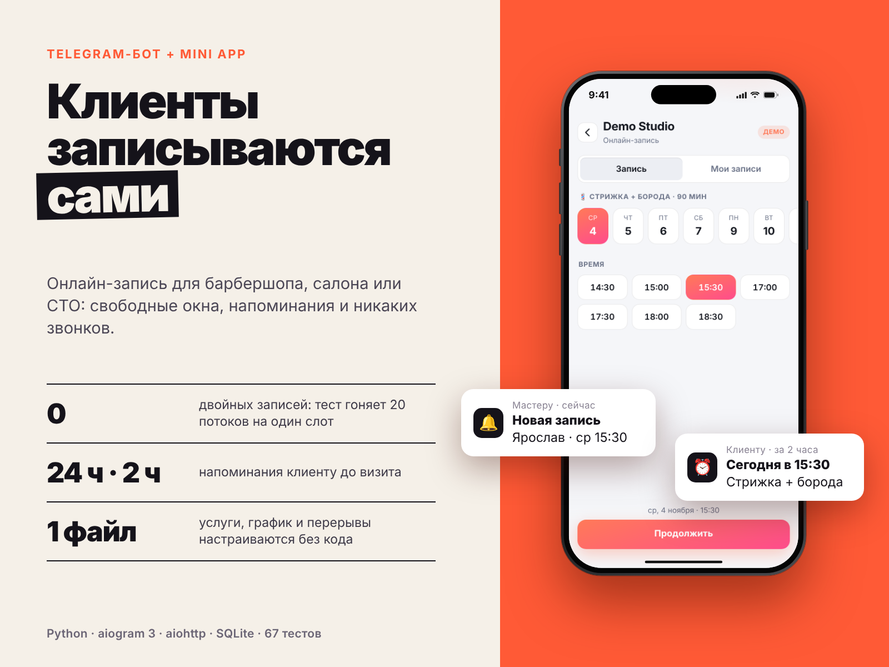
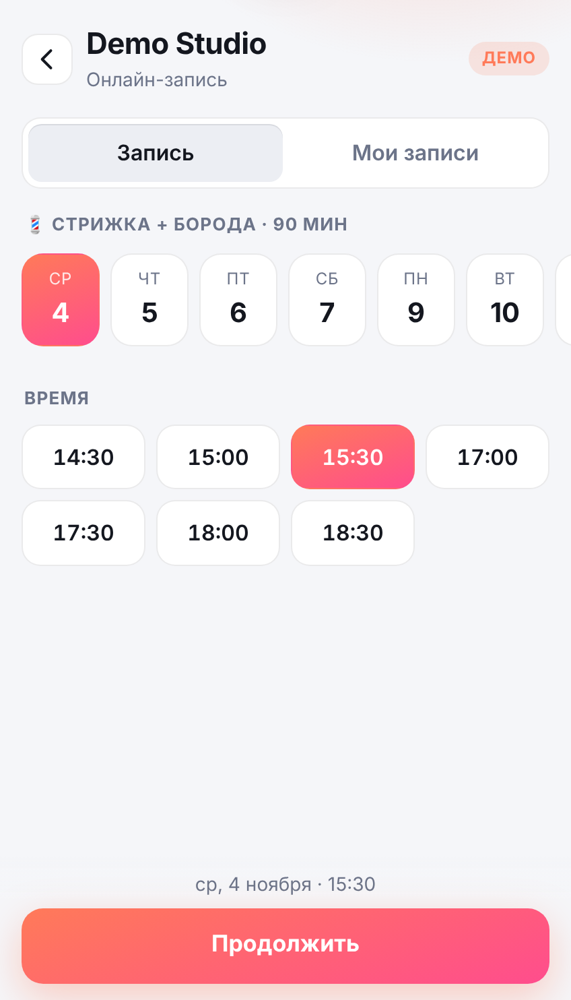
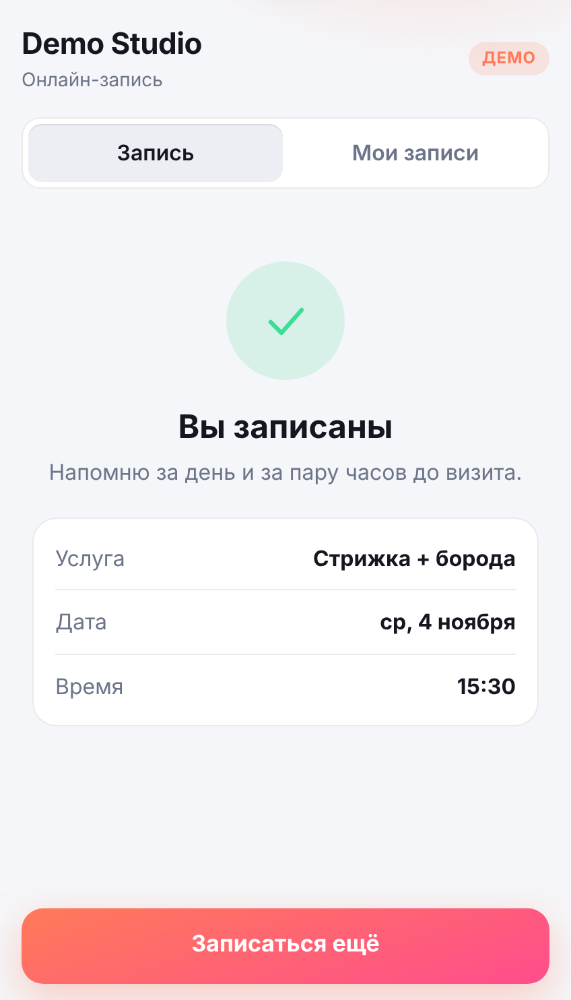

# Telegram Booking Bot

Бот онлайн-записи для барбершопа, салона, СТО или любого бизнеса с услугами и расписанием. Клиент выбирает услугу и свободное время в чате или в красивом **Telegram Mini App**, получает напоминания, а мастер управляет записями командами.



## Возможности

- Выбор услуги, дня и свободного времени — в чате (inline-кнопки) или в Mini App
- Слоты считаются из расписания: рабочие окна по дням недели, перерывы, шаг, буфер между клиентами, минимальное время до записи, горизонт записи, выходные дни
- **Защита от двойной записи**: проверка и вставка выполняются в одной транзакции SQLite (`BEGIN IMMEDIATE`). Тест запускает 20 потоков на один слот — запись получается ровно одна
- Напоминания клиенту за 24 и за 2 часа; если бот был выключен, уйдёт только ближайшее, а не пачка устаревших
- Клиент видит свои записи и может их отменить
- Панель мастера: `/today`, `/tomorrow`, `/day ГГГГ-ММ-ДД`, `/cancel ID`, `/dayoff`, `/dayon`; мастеру приходят уведомления о новых записях и отменах
- Mini App проверяет подпись `initData` (HMAC-SHA256) — подделать чужого пользователя нельзя
- Услуги, часы работы и перерывы лежат в одном файле `business.json`, код менять не нужно

## Mini App

<p>
  
  
</p>

Интерфейс подхватывает тему Telegram (светлую или тёмную), использует кнопку «Назад» и вибро-отклик. Если открыть `webapp/index.html` в обычном браузере, он работает в демо-режиме на сгенерированных данных, так что посмотреть интерфейс можно без бота.

## Структура

```
bot/
  slots.py        расчёт свободных слотов (чистая логика)
  storage.py      SQLite, транзакционная запись без двойных броней
  service.py      сценарии: записать, отменить, мои записи
  reminders.py    выбор, какие напоминания пора отправить
  webapp_auth.py  проверка подписи Mini App
  web.py          HTTP API для Mini App (aiohttp)
  handlers.py     команды и кнопки бота (aiogram 3)
  texts.py        все тексты интерфейса
webapp/           Mini App: index.html, style.css, app.js (без сборки)
tests/            75 тестов
```

Бизнес-логика не зависит от Telegram, поэтому тестируется без сети. `tests/test_live_layers.py` дополнительно прогоняет настоящий слой aiogram (апдейты подаются в `Dispatcher`, вызовы Bot API перехватываются) и все маршруты `/api/*` на локальном aiohttp-сервере с подписанным `initData`, без токена и без сети.

## Быстрый старт

```bash
git clone <ссылка-на-репозиторий>
cd telegram-booking-bot
python -m venv .venv
source .venv/bin/activate        # Windows: .venv\Scripts\activate
pip install -r requirements.txt
cp .env.example .env             # впиши BOT_TOKEN и ADMIN_IDS
cp business.example.json business.json
python -m bot.main
```

### Подключить Mini App

Mini App открывается только по HTTPS. Укажи в `.env` публичный адрес (`WEBAPP_URL=https://bot.example.com`) и пробрось порт `8080` через обратный прокси (Caddy, nginx) или туннель (например, cloudflared). Бот сам отдаёт `webapp/` и API; в меню записи появится кнопка «Открыть запись». Без `WEBAPP_URL` работает обычный сценарий на кнопках.

## Настройка под свой бизнес

Файл `business.json`: название, валюта, шаг сетки, перерывы, расписание по дням недели и список услуг (название, длительность, цена, эмодзи). Пример — `business.example.json`.

## Тесты

```bash
pip install -r requirements-dev.txt
python -m pytest
```

Тесты покрывают расчёт слотов, транзакционную запись (в том числе гонку потоков), напоминания, конфигурацию и проверку подписи Mini App.

## Статус проверки

- Бизнес-логика и тесты (67) выполнены.
- Mini App прогнан в браузере двумя способами: в демо-режиме и против реального слоя записи с подписанным `initData` (запись, «Мои записи», отмена, без ошибок в консоли).
- Слой aiogram и HTTP-сервер aiohttp написаны по документации, но живьём не запускались. Перед использованием запусти бота со своим токеном и пройди сценарий записи вручную.

## Лицензия

MIT
